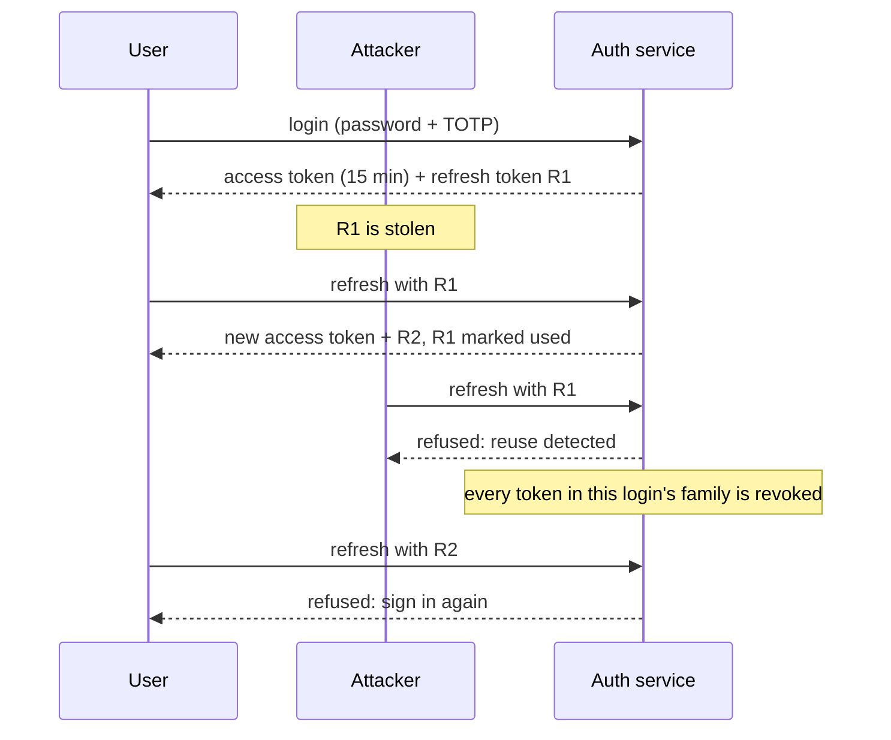

# auth-service

The core of an authentication system, written with only Python's standard library so every security decision is visible in the code: password storage, signed access tokens, rotating refresh tokens with theft detection, two-factor codes, lockout, and role-based permissions.

No dependencies. Python 3.10+.

## What is in it

| Piece | How it works | Tested by |
|---|---|---|
| Passwords | scrypt with a per-password salt. Work factors are stored in the hash, and a weaker hash is upgraded at the next successful login | salted hashes differ; wrong password and malformed hashes fail |
| Access tokens | JWT signed with HMAC-SHA256, 15-minute life. The algorithm is pinned in code, never read from the token | tampered payload, wrong key, `alg: none` and `alg: RS256` are all rejected |
| Refresh tokens | Random, single-use, stored only as a SHA-256 hash. Each use returns a new one | the raw token never appears in the database |
| Theft detection | A refresh token used twice revokes every token descended from that login | the stolen token and the legitimate newer one both stop working; other devices are unaffected |
| Two-factor (TOTP) | RFC 6238. Each code is single-use; one step of clock drift is tolerated | **matches all six RFC 6238 test vectors**; replaying a code fails |
| Lockout | 5 wrong passwords lock the account for 15 minutes | the correct password is refused while locked, accepted after |
| Roles | `viewer`, `editor`, `admin` map to permissions. The role is read from the database on each request | a role change applies to tokens already issued |
| Logout everywhere | Bumps a per-user version that access tokens carry | a still-valid, correctly signed token is refused |
| Audit log | Logins, failures, denials and reuse detections are recorded | events asserted in tests |

## Token lifecycle



Rotation alone does not stop a thief who uses the token first. Reuse detection means that whichever party comes second trips the alarm, and both are forced back to the password and second factor, which the thief does not have.

## Demo

`python -m authsvc` runs the scenarios with a fake clock:

```
1. Two-factor login
   password only: refused (totp_required)
   password + code: allowed
   same code again: refused (invalid_code)

2. Permissions follow the role
   viewer reads reports: allowed
   viewer writes reports: refused (forbidden)
   after promotion to editor, same token: allowed

3. Access tokens expire; refresh tokens rotate
   access token after 15 minutes: refused (invalid_token)
   new access token: allowed

4. A stolen refresh token is replayed
   attacker uses the old refresh token: refused (refresh_token_reused)
   the real user's newer refresh token: refused (invalid_refresh_token)

5. Brute force
   correct password after 5 wrong ones: refused (account_locked)
   correct password after the 15-minute lockout: allowed
```

## Smaller decisions that matter

- **One error for "no such email" and "wrong password"**, and a dummy hash is computed for unknown emails so both paths do the same expensive work. The intent is to avoid revealing which emails have accounts; the timing itself is not measured by a test.
- **Comparisons of secrets use `hmac.compare_digest`**, which does not stop at the first differing byte.
- **A token's role claim is not trusted.** A test signs a token claiming `admin` for a viewer and checks the service still reports `viewer`.
- **Signing secrets shorter than 32 bytes are refused** at start-up.
- **Tokens without an expiry are rejected.**

```python
from authsvc import AuthService

auth = AuthService("auth.db", secret=os.urandom(32))
user_id = auth.register("priya@example.com", "a long passphrase 42")
session = auth.login("priya@example.com", "a long passphrase 42")       # add totp_code once 2FA is on
auth.authorize(session["access_token"], "reports:read")                 # raises AuthError("forbidden") if not allowed
session = auth.refresh(session["refresh_token"])
```

```bash
pip install -e ".[dev]"
pytest -q            # 20 tests
python -m authsvc
```

## Limits

- **Not audited.** This is a learning implementation. A production system should use a maintained library or identity provider.
- **No HTTP layer, email verification or password reset.** It is the logic those would call.
- **Symmetric signing (HS256).** Every service that verifies tokens holds the key that can mint them. Asymmetric signing (RS256 or EdDSA) fixes that and is not implemented.
- **Lockout can be abused** to lock a known user out by guessing wrong on purpose. Rate limiting by IP and progressive delays are the usual complement.
- **Role lookups hit the database on every request**, trading the statelessness of JWTs for immediate revocation.
- **TOTP secrets are stored unencrypted** in the database.
